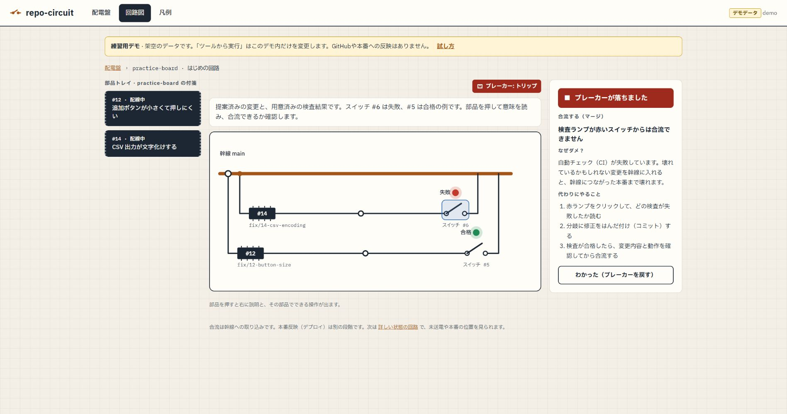

# repo-circuit

GitHub の「変更を記録し、確認してから合流する」流れを、**配線図を触りながら学べる Web アプリ**です。自作ツールの課題管理と、GitHub に慣れていない人への操作説明を一つの画面にまとめています。

付箋（Issue）から修正用の分岐（ブランチ）へ進み、はんだ点（コミット）をスイッチ（プルリクエスト）で幹線に合流します。危ない操作はブレーカーで止め、「なぜ止まるか」「次に何をするか」を表示します。

## 完成画面



架空の `practice-board` で、検査に失敗した変更を合流しようとした例です。右の説明で、止まる理由と次の行動を読めます。合格した別の変更では、影響を確認して幹線への合流を試せます。

## 学べること

| 画面で学べること | 実装・開発履歴の根拠 |
|---|---|
| 変更を提案し、検査結果を読んで合流する流れ | 付箋（Issue）、分岐（ブランチ）、スイッチ（PR）の対応を表示。[PR #18](https://github.com/h-takaha/repo-circuit/pull/18) は確認した先端が変わったら合流を止める改善 |
| 操作が止まる理由と、次に何をするか | 部品の解説とブレーカーの案内。[PR #22](https://github.com/h-takaha/repo-circuit/pull/22) は記録から本番確認までの段階別案内 |
| 合流と本番反映を分けて確認すること | 合流は幹線への取り込み。本番反映（デプロイ）は別の段階。詳しい回路でそれぞれの位置を表示 |

回路の「スイッチを閉じる」はマージの比喩です。GitHubの **Close pull request** は、合流せずにPRを閉じる別の操作です。[GitHub公式の説明](https://docs.github.com/en/pull-requests/how-tos/merge-and-close-pull-requests/closing-a-pull-request)も参照できます。検査の合格は安全の保証ではなく、変更内容や動作の確認も必要です。

## 制作で決めたこと

**GitHubに慣れていない人が操作しながら覚えるという目的と、回路の比喩を制作者が決め、AIと具体化しました。** また、自分で操作する中で迷った点を伝え、「いまの状態に合う操作を一段ずつ案内する」機能の追加を依頼しました。

コードの箇所ごとの実装分担と、初心者の学習効果は未確認です。GitHubのリンクから開発履歴を確認できます。

## デモを試す

**個人の GitHub アカウントやトークン、`.env` の準備は不要です。** Python 3.12で検証しています。Windows PowerShellで、ソースの取得から次の順に進めます。

```powershell
git clone https://github.com/h-takaha/repo-circuit.git
cd repo-circuit
python -m venv .venv
.venv\Scripts\python -m pip install -r requirements.txt
.venv\Scripts\python -m app.demo_server
```

[http://127.0.0.1:18017/](http://127.0.0.1:18017/) を開き、認証画面にユーザー名 **`demo`**、パスワード **`demo`** を入力します。起動中のターミナルは開いたままにしてください。ポートが使用中なら、起動コマンドに `--port 18018` を付けて同じ番号のURLを開きます。

最初の回路は架空の `practice-board` です。2つの変更提案と、合格／失敗の検査結果を用意しています。**デモで実際のテストを実行することはありません。**

### 約3分の体験

1. トップの **「失敗した検査のスイッチ #6 を開く」** を押します。「合流する（マージ）」の「ツールから実行」を押すと、ブレーカーが止めます。理由と、代わりにやることを読めます。
2. トップの **「検査に合格したスイッチ #5 を開く」** へ進み、同じ操作を試します。影響を読み、「実行する」を押します。幹線に変更が入り、付箋 #12 が完了になります。
3. **「凡例」** で、触った部品と GitHub の用語の対応を確認します。

「ツールから実行」はメモリ上の擬似操作です。**合流してもGitHubや本番は変更しません。**

慣れたら **「詳しい状態の回路を見る」** から `practice-details` へ進めます。未コミット・未送電・古いコピー・放置分岐・本番の位置と、作業場所（worktree）の例を別の回路で確認できます。[PR #19](https://github.com/h-takaha/repo-circuit/pull/19) は、作業場所の取り込み根拠と残存ファイルを分けて表示した改善です。

<details>
<summary>デモの範囲と終了方法</summary>

既存の環境変数にトークンがあっても使わず、`.env`、GitHub API、手元の開発repo・稼働フォルダを読みません。接続先はこのPCの `127.0.0.1` に固定しています。デモ用の共通パスワードを使うため、外部公開用の起動方法ではありません。

詳しい回路の本番の旗は固定サンプルで、合流後も実際のデプロイは行いません。「コマンドで言うと」は学習用です。デモのコマンドを自分のターミナルで実行する手順はありません。

終了はターミナルで **Ctrl+C**。同じコマンドで再起動すると、回路・付箋は初期状態に戻ります。ブレーカーの操作名・ルールIDとフォームの二重送信防止用IDは、無視対象の `.demo-data/` に残ります（入力本文は記録しません）。

</details>

## 詳しい画面と構成

- **配電盤**: 全ツールを1行ずつ。赤いランプ・錆びた配線・本番の遅れがある回路が上に来る
- **回路図**: 1ツールの配線図。部品を押すと解説とできる操作が出る。合流による幹線の変化と、別の配布処理による本番の到達位置を表示する
- **作業場所（worktree）**: 回路図の隣のタブで、主作業場所と追加の登録を全件表示。実際の先端、取り込みの根拠、残っているファイルの要約を確認する
- **部品トレイ**: 全ツールの付箋（Issue）を 未接続 / 配線中 / 完了 の3列で。ここから起票できる
- **凡例**: 回路記号と GitHub 用語の対応、ブレーカーの一覧

実装は Python / FastAPI / Jinja2 と JavaScript / SVG で構成しています。データ源をGitHubとデモで切り替え、画面と安全確認には同じ状態モデルを使います。設計は [CONTEXT.md](CONTEXT.md)、紹介に向けた根拠と残課題は [作品の確認メモ](docs/PORTFOLIO_REVIEW.md) にまとめています。

## 実データで使う場合

以下は自分のGitHubを操作するための運用手順です。上のデモ体験には不要です。実データの標準ポートは8017です。

```powershell
python -m venv .venv
.venv\Scripts\pip install -r requirements.txt
copy .env.example .env   # GITHUB_TOKEN と BASIC_AUTH_PASSWORD を記入
.venv\Scripts\python -m uvicorn app.main:app --port 8017 --env-file .env
```

`GITHUB_TOKEN` が空なら**デモモード**（サンプルの回路。書き込みはメモリ上の擬似実行）で動く。
`BASIC_AUTH_PASSWORD` が空だと全ページ 401（fail-closed）。`/healthz` だけ認証なし。

## 作業場所を確認する

`/repo/<ツール名>/worktrees` は読み取り専用の一覧です。GitHub の合流と、手元のフォルダ・ファイルが残っていることを別々に示します。回路図と作業場所は通常のリンクで移動でき、ツールを切り替えても選択中のタブを保ちます。

取り込み状況は「確認済み」「合流記録あり・到達未確認」「取り込み未確認」「判定不明」の4状態です。ローカルの GitHub コピーを使うため、証拠の取得元と古さも確認してください。アプリは fetch しません。GitHub が取得できなくても、有効なローカル repo の登録を表示します。

ファイル数は変更済み・未追跡・無視対象の**要約パス件数**です。まとめて報告されるディレクトリは1件で、`.venv` の中などを再帰的に数えません。0は取得して該当なし、未取得は数が分からない状態です。詳細には各分類20件までのパス例を表示します。

整理前は、使用終了の確認 → 必要ファイルの退避と復元確認 → 管理元で作業場所の整理 → 必要なら残った分岐の整理、の順に進めます。管理元はパスから推定した候補です。登録の prune とフォルダ削除は別操作であり、この画面には削除・退避・整理コマンドのコピー機能はありません。

## 作業台を最新の幹線に揃える

回路図の「変更を記録して本番まで届ける」では、記録するファイルを選ぶ → はんだ付け（コミット）→ 送電（push）→ スイッチ作成（PR）→ 検査 → 合流（マージ）→ 本番確認の順に、現在の状態に合う手順を表示します。コマンドの意味と対象を確認してコピーし、PowerShellで実行後「実行後、状態を読み直す」を押してください。コピーだけでは進みません。ファイルは自分で選び、コミットの名前も入力します。分岐・HEADと記録対象の変化、取得失敗、ショートを確認できた場合は止めます。GitHub操作は既存のブレーカー付き確認・実行を使います。

案内するコミットには `[no-push] [no-deploy]` を付け、直後の自動操作を抑えます。幹線へのマージ後の定期自動配布は別です。アプリは作業台のコマンドや本番更新を実行しません。本番の位置が追いついた後、実際の画面も確認してください。

修正を合流した後は、回路図の下の「作業台を最新の幹線に揃える」から、fetch → 幹線へswitch → merge --ff-only の順に案内を開けます。「ターミナルから実行」で一つずつコピーし、成功を確認して次へ進みます。未コミットの変更は先に確認・記録してください。履歴が分かれている場合は更新が停止します。最後に回路図を再読み込みし、作業台の旗が幹線の先端と同じ位置になったか確認します。

回路図を上、工程表を下に表示します。工程表は最大8行で進行中の作業を優先します。合流済みは通常3件を表示し、現在残っている完了分岐が多い場合は8行の範囲内で増やします。

## AI（Claude / Codex）からの起票

```http
POST http://localhost:8017/api/issues
Content-Type: application/json
Authorization: Basic ...

{"repo": "your-repo", "title": "保存ボタンが見つけにくい", "situation": "…", "want": "…",
 "kind": "improvement", "priority": "p2", "source": "claude"}
```

- `kind`: `bug` / `improvement` / `idea`、`priority`: `p1` / `p2` / `p3`
- 付くラベル: `feedback` ＋ kind ＋ priority（無ければ自動作成）
- 秘密情報らしき文字列を含むと 422（ブレーカー）
- 共通 skill は agent-ops の `configs/shared/skills/tool-issue/SKILL.md`。アプリが動いていないときは同じラベル・同じ本文テンプレで `gh issue create` する

読み取り: `GET /api/repos`、`GET /api/issues?repo=<name>&state=open|closed|all`

付箋から修正へ進むときは、付箋を押して「この付箋用に分岐を引く」を選びます。`fix/<番号>-...` の分岐がGitHubにあると「配線中」になります。ローカルだけの分岐は送電（push）するまで「未接続」のままです。修正した分岐のスイッチ（PR）の説明に `Fixes #番号` を書くと、合流時に付箋も自動で「完了」になります。ローカルで修正・検証しただけでは完了にしません。

合流済み分岐の撤去は、古いPRも分岐名で追加確認します。追加確認は最大3ページで、通常表示は最大60秒のcacheを含みます。確認・実行時は最新状態を読み直し、取得失敗や証拠不足はブレーカーで止めます。

## テスト

### 検査ランプが「取得不可」の場合

Checks API が 403 を返したときは、代わりに **GitHub Actions の実行結果**（PAT の Actions 読み取り権限）で検査ランプを決めます。

| Actions の状態 | 検査ランプ |
|---|---|
| その PR の先端で実行がある | 合格 / 失敗 / 検査中（ワークフローごとに最新の実行を見る） |
| repo にワークフローが1つも無い | 検査なし（合流は「注意」で確認すれば進める） |
| ワークフローはあるのに、その先端の実行が無い／Actions API も 403 | **取得不可** |

Actions 以外の外部 CI（GitHub App が付ける check など）の結果は Actions API では見えません。

取得不可のときも配電盤と回路図は表示します。「検査なし」や「合格」とは扱わず、
ブレーカーがアプリからの合流（マージ）を止めます。確認を押しても解除できません。

Fine-grained PAT は現在 Checks API に対応しておらず、設定画面で Checks 権限を追加することもできません
（[GitHub の Fine-grained PAT の制約](https://docs.github.com/en/authentication/keeping-your-account-and-data-secure/managing-your-personal-access-tokens#fine-grained-personal-access-tokens-limitations)）。
検査結果を取得するには、GitHub App など Checks API に対応した認証方式と、必要な読み取り権限を検討してください。
認証方式の変更には別途設定が必要です。取得できるようになったら、画面を再読み込みしてください。
403 以外の Checks API エラーや、PR 詳細など他の API の 403 は通常の取得エラーとして扱います。

### 実行

```powershell
.venv\Scripts\pip install -r requirements-dev.txt
.venv\Scripts\python -m pytest
```

デモの隔離・認証・成功／停止の体験は `tests/test_showcase.py` で検証します。テスト結果とブラウザで確かめた範囲は [作品の確認メモ](docs/PORTFOLIO_REVIEW.md) に記録します。

## 実機への導入チェックリスト（Hiroy）

1. **PAT を発行**: GitHub → Settings → Developer settings → Fine-grained tokens。対象 = h-takaha の全 repo、
   権限 = Issues RW / Pull requests RW / Contents RW / Actions RW / Metadata R（`.env.example` と同じ）
2. **稼働クローン**: `git clone https://github.com/h-takaha/repo-circuit C:\lab\run\repo-circuit`
3. **venv**: `C:\lab\git\agent-ops\setup\phase3\setup-tool-venv.ps1` で `C:\lab\run\repo-circuit\.venv` を作る
4. **.env**: `C:\lab\run\repo-circuit\.env` に PAT と Basic 認証値（画面・ログ・コミットに出さない）
5. **server_manager**: server-manager repo の `tools.json` に `repo_circuit`（port 8017。8014 は task_manager、8015 も使用中、`uvicorn app.main:app --port 8017 --env-file .env`）を追加（PR 経由）
6. **自動デプロイ（任意）**: agent-ops の `automation/config/autodeploy.json` に
   `"repo-circuit": { "restart": "server-manager", "serverManagerName": "repo_circuit" }`
7. **AI 起票 skill**: agent-ops で `node deploy.js --diff` → 内容確認 → `node deploy.js --apply --force`
8. **動作確認**: 配電盤に全ツールが並ぶ / 部品トレイから起票 → GitHub に Issue / Claude に「○○の△△を直したい」→ 同じトレイに出る /
   付箋から分岐 → 作業台でコミット・push → スイッチを付ける → 検査ランプ緑で閉じる → 付箋が自動で完了、本番の旗が追いつく
